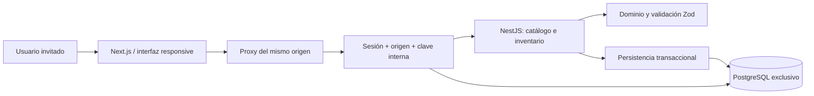

# Arquitectura de la fase 2

## Decisión principal

Monolito modular con API NestJS centralizada y PostgreSQL. Next.js presenta la interfaz y reenvía solicitudes del mismo origen; no decide reglas comerciales ni accede directamente a la base. Los procesos web y API se ejecutan por separado sin convertir el sistema en microservicios.

`packages/domain` no depende de React, NestJS ni PostgreSQL: contiene validaciones, tipos y reglas puras. `packages/database` mantiene esquema Drizzle y migraciones. Catálogo usa Drizzle; inventario y autenticación usan consultas SQL parametrizadas con el driver PostgreSQL para expresar bloqueos, sesiones y validaciones de historial. La interfaz importa contratos del dominio y no dispone de credenciales de base.

## Acceso

`AuthModule` instala un guard global. Salvo salud, las rutas requieren la clave interna del proxy. Las operaciones del negocio requieren además una sesión válida; login y logout admiten ausencia de sesión, pero mantienen validación de origen y clave interna. El identificador del actor proviene del usuario autenticado, nunca del cuerpo de una mutación.

Las contraseñas se derivan con scrypt y sal aleatoria. El token de sesión es aleatorio; la base conserva su hash SHA-256. La sesión tiene un máximo de 8 horas y 30 minutos de inactividad, se revoca al salir y se invalida al restablecer la contraseña. Las cookies son `HttpOnly`, `SameSite=Strict`, con `Secure` y prefijo `__Host-` en staging. Login tiene presupuestos de intentos persistidos por usuario y globales.

No hay registro público ni roles diferenciados. La preparación de usuarios se hace fuera de la API con `scripts/create-user.ts` y un archivo privado. El arranque local genera el acceso en `.local/auth-local.json`; staging exige provisión explícita. `MM_APP_ENV` distingue `local`, `test` y `staging`; `MM_APP_ORIGIN` debe ser HTTPS con dominio confirmado para staging. El proxy no expone la clave interna al navegador.

## Contrato HTTP

| Método     | Ruta                                                                | Comportamiento                                                       |
| ---------- | ------------------------------------------------------------------- | -------------------------------------------------------------------- |
| GET        | `/api/health`                                                       | Salud y conexión a PostgreSQL                                        |
| POST       | `/api/auth/login`, `/api/auth/logout`                               | Iniciar o revocar sesión                                             |
| GET        | `/api/auth/me`                                                      | Usuario y entorno de la sesión                                       |
| GET        | `/api/catalog`                                                      | Catálogo en un snapshot consistente                                  |
| POST       | `/api/catalog/fruits`, `/varieties`, `/calibers`, `/configurations` | Altas de catálogo; todas bajo `/api/catalog`                         |
| PATCH      | `/api/catalog/configurations/:id`                                   | Editar empaque con versión                                           |
| GET / POST | `/api/suppliers`                                                    | Listar o crear proveedores                                           |
| PATCH      | `/api/suppliers/:id`                                                | Editar o desactivar con versión                                      |
| POST       | `/api/receipts`                                                     | Recepción multilínea atómica; lote por línea                         |
| GET        | `/api/inventory`                                                    | Resumen y lotes; filtros por fruta, variedad, calibre, lote y estado |
| GET        | `/api/inventory/lots/:id`                                           | Lote, contenedores e historial                                       |
| POST       | `/api/inventory/lots/:id/open-box`                                  | Abrir caja según su empaque histórico                                |
| POST       | `/api/inventory/lots/:id/withdraw-blisters`                         | Retiro interno priorizando cajas abiertas                            |
| POST       | `/api/inventory/lots/:id/open-blister`                              | Abrir blíster con conteo físico                                      |
| POST       | `/api/inventory/lots/:id/prepare-half`                              | Preparar media caja y conservar remanente                            |
| POST       | `/api/inventory/lots/:id/adjust`                                    | Ajustar cantidad/conteo con motivo                                   |
| POST       | `/api/inventory/movements/:id/reverse`                              | Reversa compensatoria del último movimiento admisible                |

Las mutaciones de negocio requieren `Idempotency-Key` UUID. Una clave idéntica con los mismos datos y actor devuelve la respuesta guardada; con distinto contenido produce conflicto. Catálogo y proveedores comprueban la versión en sus ediciones. Los cuerpos de inventario están en `packages/domain/src/inventory.ts`; [inventory-model.md](inventory-model.md) explica sus efectos físicos.

## Transacciones de inventario

La recepción bloquea proveedor y configuración y copia el empaque, su versión y el costo en cada lote. Cada caja recibida tiene identidad propia; su cantidad de fruta queda desconocida. Abrirla crea los blíster de la configuración histórica sin añadir un saldo duplicado del recipiente abierto.

Los comandos bloquean en orden clave idempotente → árbol de inventario → lote → saldos por ID. El bloqueo global del árbol es una protección conservadora de esta fase y limita concurrencia entre lotes. No se hacen llamadas externas dentro de las transacciones. Los conflictos transitorios permiten reintentar el mismo comando y clave.

Una sola transacción inserta movimiento y entradas, actualiza contenedores/proyección y versión del lote, registra auditoría y conserva la respuesta. Las restricciones diferidas comprueban sumas de entradas por unidad, estado de la proyección, árbol físico y cadena de versiones antes de confirmar. Los movimientos contienen estados anteriores/posteriores para reversas; solo se revierte el último movimiento del lote, una vez, sin borrar registros.

Las lecturas de catálogo e inventario usan snapshots consistentes. No se exponen clientes de base al navegador ni se hace una consulta por cada fila. Los pools son acotados; las consultas de inventario tienen límites de espera de conexión, bloqueo y ejecución.

## Modelo PostgreSQL

27 tablas y una vista de cuentas por cobrar:

| Área                 | Tablas / vista                                                                           |
| -------------------- | ---------------------------------------------------------------------------------------- |
| Catálogo             | `fruits`, `varieties`, `calibers`, `product_variants`, `packing_rules`                   |
| Abastecimiento       | `suppliers`, `purchases`, `purchase_lines`, `lots`                                       |
| Inventario           | `warehouses`, `containers`, `stock_balances`, `inventory_movements`, `inventory_entries` |
| Acceso               | `app_users`, `auth_sessions`, `auth_login_buckets`                                       |
| Comercial futuro     | `clients`, `price_lists`, `price_items`, `sales`, `sale_lines`                           |
| Cobranza futura      | `payments`, `payment_applications`, vista `receivables`                                  |
| Tasas y trazabilidad | `bcv_rates`, `audit_events`, `command_receipts`                                          |

Se usan UUID, timestamps con zona horaria, claves foráneas, índices, unicidad y restricciones de cantidades. Las claves compuestas impiden mezclar frutas entre variedad/calibre o vincular un lote con una regla de otra variante. Los costos usan `numeric` y cadenas decimales en TypeScript; el calibre permanece como etiqueta de texto.

Las tablas comerciales, de cobros y BCV son fundamentos de fases posteriores: no tienen endpoints operativos ni permisos de escritura del rol de aplicación. No representan un sistema de facturación listo. El almacén inicial existe sin inventario ficticio; los lotes de staging/pruebas se identifican como DEMO desde el servidor.

## Migraciones

| Migración                          | Responsabilidad                                                                                        |
| ---------------------------------- | ------------------------------------------------------------------------------------------------------ |
| `0000_thick_sunset_bain.sql`       | Esquema inicial generado por Drizzle                                                                   |
| `0001_integrity.sql`               | Historial inmutable, ciclos y doble conteo                                                             |
| `0002_noisy_red_ghost.sql`         | Restricción del dominio oficial BCV                                                                    |
| `0003_inventory_phase2.sql`        | Proveedores, recepción/lotes, proyección y ledger consistentes, estados físicos, versiones y snapshots |
| `0004_auth_sessions.sql`           | Usuarios invitados, sesiones revocables y limitación de intentos                                       |
| `0005_inventory_history_guard.sql` | Entradas creadas únicamente en la misma transacción del movimiento y consistentes con sus snapshots    |

Journal e instantáneas Drizzle se versionan. El migrador toma un bloqueo asesor, aplica pendientes y concede permisos mínimos a `mm_app`. `mm_owner` se usa solo para preparación y migración. Una migración aplicada se conserva; la siguiente incorpora la corrección. No se usa `drizzle-kit push`.

El migrador solo admite bases del proyecto en loopback/puerto 55432 o `manzanas_maracay_staging` en el servicio `postgres:5432` con `MM_APP_ENV=staging`. La configuración no habilita migrar bases ajenas. Los triggers limitan cambios históricos aunque el rol tenga permiso de actualización de la proyección.

## Entornos y ejecución

| Entorno               | Web / API                                       | Base                                                             |
| --------------------- | ----------------------------------------------- | ---------------------------------------------------------------- |
| Local                 | `127.0.0.1:3100` / `127.0.0.1:3101`             | `manzanas_maracay_dev`, PostgreSQL portable en `127.0.0.1:55432` |
| Pruebas automatizadas | `127.0.0.1:3200` / `127.0.0.1:3201`             | `manzanas_maracay_test`, nunca staging                           |
| Staging activo        | `https://manzanas.ganamosclub.net`, API interna | Base, red, volumen y credenciales exclusivos                     |

Staging está activo sobre `phase2-7ae1d75`, commit `7ae1d7504d31623e771fba5015361ae04ca9a4ef`. Tras la aprobación específica se añadió DNS y el host de Caddy, con recarga sin reiniciar servicios. Una colisión del alias genérico `web` produjo un 502 temporal en Socios; se corrigió renombrando el servicio propio a `mm-staging-web`. La red se reconectó con prioridad de gateway −1, conservando la ruta por defecto y las demás rutas previas del proxy. Cinco rondas GET verificaron Manzanas, Socios y Pedal, y se repitió el smoke HTTPS de sesión. API y PostgreSQL permanecen internos. [infrastructure.md](infrastructure.md) registra la incidencia y su resolución. No se desplegó producción.

`npm run dev` prepara e inicia el entorno local; `npm run check` ejecuta tipos, unitarias y compilación; `npm run test:e2e` administra sus servicios de prueba. PostgreSQL portable mediante `embedded-postgres` se limita a desarrollo/pruebas. El flujo Docker local es una alternativa que requiere validación en una máquina con Docker; no debe usar el puerto 55432 a la vez que la base portable.

## PWA y límites

El manifiesto y los iconos derivan del logo oficial, documentado en [brand-assets.md](brand-assets.md). El service worker ofrece una página de desconexión; no guarda respuestas operativas ni encola escrituras. Las capturas de Chromium no equivalen a validación en todos los dispositivos o Safari.

El ensayo de restauración de staging se completó en recursos aislados y se verificó su limpieza. Antes de usar datos comerciales reales falta una copia segura fuera del VPS y la revisión del propietario; antes de producción deben revisarse además retención, observabilidad, recuperación de acceso, volumen real, paginación y contención del inventario. Esta fase no incorpora ventas, cobranza, listas de precios operativas, WhatsApp, transferencias entre almacenes ni proveedor BCV en vivo. La [entrega de fase 2](entrega-fase-2.md) distingue pruebas locales, comprobaciones externas y release desplegada.
