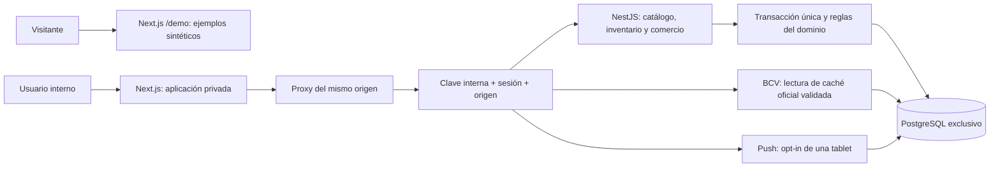

# Arquitectura de la Fase 3

## Monolito modular y separación de acceso

Next.js presenta la interfaz; NestJS concentra reglas operativas y acceso a PostgreSQL. Web y API se ejecutan por separado. El navegador no recibe credenciales de base ni la clave interna del proxy.

`/demo` contiene datos sintéticos estáticos y filtros locales, sin consultar la API privada ni persistir operaciones. El acceso interno conserva sus usuarios y sesiones. La demo no convierte endpoints existentes en anónimos. La raíz distingue demostración y acceso interno; la disponibilidad en el host público depende de la release registrada en [staging.md](staging.md).

`packages/domain` contiene tipos, validaciones Zod y reglas puras, sin React, NestJS ni PostgreSQL. `packages/database` conserva esquema Drizzle y migraciones. Los servicios usan SQL parametrizado cuando necesitan expresar bloqueos y validaciones transaccionales; Drizzle mantiene también los snapshots de esquema. Las reglas comerciales primarias están en [domain-rules.md](domain-rules.md).

## Autenticación y frontera HTTP

`AuthModule` instala un guard global. Salvo salud, las rutas requieren la clave interna del proxy. Las operaciones privadas requieren además sesión válida; login/logout mantienen sus controles de origen y clave interna. El actor se obtiene de la sesión, nunca de un campo suministrado por el navegador.

Las contraseñas usan scrypt y sal aleatoria. Los tokens de sesión son aleatorios y la base almacena su hash SHA-256. Máximo de sesión: ocho horas, con treinta minutos de inactividad. Cerrar sesión o restablecer contraseña revoca el acceso correspondiente. Cookies `HttpOnly`, `SameSite=Strict`, y `Secure`/prefijo `__Host-` en staging. Login tiene límites persistidos por usuario y globales. No hay registro público ni roles diferenciados.

Los usuarios se provisionan mediante `scripts/create-user.ts` y archivos privados. `MM_APP_ENV` y `MM_APP_ORIGIN` diferencian entornos y staging requiere HTTPS con origen confirmado. El proxy permite únicamente rutas/métodos definidos, conserva respuestas `no-store` y valida el tipo de los documentos binarios permitidos. La autenticación de descarga PDF es la misma que la de otros datos privados.

## Módulos y rutas

Todas las rutas de esta tabla están bajo `/api`; salud y autenticación tienen las excepciones descritas arriba.

| Módulo                  | Rutas principales                                                                                                     | Responsabilidad                                                                        |
| ----------------------- | --------------------------------------------------------------------------------------------------------------------- | -------------------------------------------------------------------------------------- |
| Salud/autenticación     | `GET /health`, `POST /auth/login`, `POST /auth/logout`, `GET /auth/me`                                                | Salud, sesión y revocación.                                                            |
| Catálogo                | `GET /catalog`; altas de frutas/variedades/calibres/configuraciones; edición de configuración y renombrado autorizado | Capacidades de empaque, campos opcionales, configuración con versión y auditoría.      |
| Proveedores/recepciones | `GET/POST /suppliers`, `PATCH /suppliers/:id`, `POST /receipts`                                                       | Recepción multilínea atómica con costo histórico y cambios explícitos de precios.      |
| Inventario              | `GET /inventory`, `GET /inventory/lots/:id`, comandos POST por lote y reversa por movimiento                          | Único stock físico, ledger, proyección y costo.                                        |
| Clientes                | `GET/POST /clients`, `GET/PATCH /clients/:id`                                                                         | Ficha, teléfono internacional, historial y saldos por comprobante; edición versionada. |
| Precios                 | `GET/POST /prices`                                                                                                    | Dos referencias USD por presentación, independientes del costo de compra.              |
| Ventas                  | `GET/POST /sales`, `GET /sales/:id`, `POST /sales/:id/dates`, `POST /sales/:id/cancel`                                | Confirmación con FIFO, crédito/contado, fechas históricas y compensación.              |
| Abonos                  | `GET/POST /payments`, `GET /payments/:id`, `POST /payments/:id/reverse`                                               | Reparto explícito, moneda original, equivalente USD e historial.                       |
| Cobranza                | `GET /collections`                                                                                                    | Saldo vigente, vencimientos y recordatorios independientes en America/Caracas.         |
| Documentos              | `GET /sales/:id/document`, `GET /payments/:id/document`                                                               | PDF comercial privado con logo, importes y saldos; no documento fiscal.                |
| BCV                     | `GET /rates/current`                                                                                                  | Disponibilidad de un registro oficial verificable, nunca una tasa inventada.           |
| Push                    | `GET /push/status`, `POST /push/subscribe`, `POST /push/unsubscribe`                                                  | Configuración y opt-in de una sola tablet; reemplazo explícito.                        |

Los comandos de inventario siguen bajo `/inventory/lots/:id`: `open-box`, `withdraw-blisters`, `open-blister`, `prepare-half`, `split-halves`, `adjust`; la reversa usa `/inventory/movements/:id/reverse`. Los contratos están en `packages/domain/src/inventory.ts` y `commerce.ts`.

## Una transacción para mercancía y comercio

`InventoryService.runCommand` administra conexión, transacción, idempotencia y orden de bloqueo común. Las mutaciones de negocio requieren `Idempotency-Key` UUID; huella = operación, datos normalizados y actor. Repetirla devuelve la respuesta registrada; reutilizarla con otra huella produce conflicto.

Orden de bloqueo: clave idempotente → árbol de inventario → lotes/saldos/documentos en orden estable. El bloqueo global del árbol es deliberadamente conservador. SQL también toma ese bloqueo en escrituras comerciales para impedir que una escritura directa evada la serialización. No hay red externa dentro de la transacción. Pools y esperas de conexión/consulta están acotados.

La recepción confirma documento, lotes, cajas, costos, auditoría, precios elegidos y respuesta en un solo commit. Comercio llama `consumeSale` con el mismo `PoolClient`: inserta comprobante/líneas, asigna lotes FIFO, retira recipientes y conserva `sale_allocations` con lote, recipiente, movimiento y costo. El abono inicial opcional participa en ese commit. No se vuelve a descontar un stock independiente.

Cada lote conserva configuración y costo de ingreso. Cada recipiente tiene proyección física y costo actual. `inventory_entries` y `inventory_cost_entries` son historiales inmutables; las restricciones diferidas concilian proyección, árbol, snapshots, versiones y costo. `inventory_cost_openings` aporta una base trazable para saldos heredados de Fase 2 sin modificar eventos anteriores. El costo desconocido bloquea la venta que lo necesita.

`sale_allocations` permite verificar que cada presentación vendida corresponde al recipiente despachado y que sus costos suman el egreso real. PostgreSQL impide insertar hijos tardíos de una venta o pago, alterar documentos históricos, sobrepagar y confirmar una venta sin salida de mercancía. Detalles físicos y de redondeo en [inventory-model.md](inventory-model.md).

## Deuda, pagos y rectificaciones

Las ventas conservan descripción, cliente y precio de referencia/pactado históricos. Costos tienen cuatro decimales; importes comerciales suman renglones redondeados a dos con Decimal. Contado exige cubrir el total; crédito admite no pagar inicialmente. Cero significa ausencia de abono, no un asiento monetario.

La deuda está en USD. `payment_applications` reparte explícitamente cada pago entre comprobantes del mismo cliente; su suma debe coincidir con el equivalente USD recibido, sin exceder saldos. `receivables` deriva saldo vigente excluyendo anulaciones y abonos revertidos; no es un saldo editable desde la UI. Consultas de cobranza limitan filas y exponen total/truncamiento cuando corresponde.

`sale_date_events` separa fecha pactada de recordatorio interno y conserva cada cambio. `sale_cancellations` y `payment_reversals` registran compensaciones. Anular exige no tener abonos activos y que los movimientos de los lotes puedan revertirse sin operaciones posteriores. No hay borrado de documentos ni devoluciones parciales improvisadas.

## BCV, PDF y comunicaciones

`BcvModule` implementa `OfficialRateProvider` mediante caché histórica validada en servidor. Un registro válido exige fuente HTTPS oficial, hash, tasa positiva, consulta/verificación no futuras, intervalo vigente y ausencia de duplicados aplicables. La validación se repite al confirmar el cobro. El navegador no suministra la tasa; cambiarla después no cambia la deuda USD histórica.

La fuente oficial no se pudo verificar de forma confiable en esta fase; no se desactivó TLS ni se usó una alternativa no oficial. Sin registro válido se devuelve tasa no disponible y se bloquea VES, preservando operaciones USD. No hay recolector externo automático habilitado ni fixture presentado como tasa real. [bcv.md](bcv.md) registra comprobación y límites.

`commerce-pdf.ts` genera comprobantes y recibos con `pdf-lib`, logo original local, fechas de Caracas, numeración comercial y datos históricos. Las ventas muestran saldo/abonos consultados; los recibos identifican aplicaciones y saldo resultante. No se exponen costos de compra en el comprobante del cliente ni se afirma validez fiscal SENIAT. [pdf-qa-fase-3.md](pdf-qa-fase-3.md) distingue renderización visual de validación por la API y explica el límite de caracteres WinAnsi.

WhatsApp abre `wa.me` con teléfono internacional guardado, comprobante y saldo actual obtenido al pulsar. El operador envía; no hay Meta Cloud API ni envío autónomo.

Push requiere claves VAPID fuera de Git y opt-in de una sola tablet. Sin configuración queda deshabilitado. El proceso revalida deuda/fecha/suscripción, deduplica comprobante/fecha y envía avisos genéricos sin datos privados. No mantiene una transacción abierta durante la llamada al proveedor. El centro autenticado es el fallback; aceptación del proveedor no acredita recepción en Android/iOS. [push-cobranza.md](push-cobranza.md) detalla permisos, seguridad y prueba real pendiente.

## Migraciones y entornos

| Migración                          | Responsabilidad                                                                                 |
| ---------------------------------- | ----------------------------------------------------------------------------------------------- |
| `0000_thick_sunset_bain.sql`       | Esquema inicial generado por Drizzle.                                                           |
| `0001_integrity.sql`               | Historial, ciclos y doble conteo.                                                               |
| `0002_noisy_red_ghost.sql`         | Dominio oficial BCV.                                                                            |
| `0003_inventory_phase2.sql`        | Proveedores, recepción, ledger físico, estados, versiones y snapshots.                          |
| `0004_auth_sessions.sql`           | Usuarios invitados, sesiones y límites de intentos.                                             |
| `0005_inventory_history_guard.sql` | Entradas creadas en la transacción de su movimiento.                                            |
| `0006_packaging_phase3.sql`        | Modalidades configurables, piezas desconocidas y ledger de costo.                               |
| `0007_commerce.sql`                | Clientes, listas operativas, ventas/asignaciones, abonos, eventos y restricciones.              |
| `0008_push.sql`                    | Suscripción única y deduplicación de avisos.                                                    |
| `0009_empty_stock_cost_guard.sql`  | Impide conservar costo positivo en recipientes sin cantidad.                                    |
| `0010_commercial_json_alias.sql`   | Califica valores JSON al validar asignaciones comerciales, sin colisión con columnas textuales. |

Journal y snapshots Drizzle se versionan. El migrador usa bloqueo asesor y permisos mínimos para `mm_app`; `mm_owner` queda para preparación/migraciones. No se reescriben migraciones aplicadas ni se usa `drizzle-kit push`. BCV se concede en lectura al rol operativo; secretos y sesiones nunca se incluyen en entregables públicos.

| Entorno        | Web/API                                         | Base                                                                                     |
| -------------- | ----------------------------------------------- | ---------------------------------------------------------------------------------------- |
| Local          | `127.0.0.1:3100` / `127.0.0.1:3101`             | `manzanas_maracay_dev`, PostgreSQL portable local `55432`.                               |
| E2E            | `127.0.0.1:3200` / `127.0.0.1:3201`             | `manzanas_maracay_test`, separada de staging.                                            |
| Migraciones QA | Sin servicios web                               | Bases `manzanas_maracay_migration_test_<12hex>` creadas y retiradas por el ensayo local. |
| Staging        | `https://manzanas.ganamosclub.net`; API interna | Base, red, volumen y credenciales exclusivos.                                            |

El ensayo de migraciones usa el código exacto de Fase 2 para crear un historial válido, aplica la actualización y compara identidades/datos previos. Crea solo bases temporales con nombre aleatorio comprobado, propietario y marcador propios; limpia sin `FORCE`. El [informe](verificacion-migraciones-fase3.json) registra qué migraciones pasaron, sin sustituir la suite E2E.

La ejecución `2b09937b4ce6d75ddacd867c` verificó once migraciones fresh/upgrade el 4 de noviembre de 2026, 22:54:14–22:54:29 UTC. Conservó 16 tablas previas y seis hashes; ambas bases temporales propias fueron retiradas. Tras corregir dos desbordes a 390 px, la verificación final local aprobó typecheck/build, 90 unitarias y 53/53 E2E en 4,3 minutos. Véase la entrega para los límites de esta evidencia.

La PWA conserva manifiesto/iconos de marca, página offline y avisos genéricos. No guarda respuestas operativas ni encola escrituras offline. La UI retiene la clave idempotente tras una respuesta perdida para reintentar el mismo comando.

El estado desplegado, backup/restauración, alias exclusivo `mm-staging-web`, controles de recursos y rollback se documentan en [staging.md](staging.md) e [infrastructure.md](infrastructure.md). Cambios de DNS/proxy/firewall/red compartida requieren autorización específica. La nueva demo no autoriza tocar aplicaciones ajenas. Producción sigue pendiente de copia externa segura, revisión fiscal y validación en dispositivos reales; el estado de implementación no equivale a una release desplegada.

La demo temporal web está activa como `demo-db16c5745423` desde el commit `db16c574542347cc15c89498184873b9e5953d84` y verificada externamente a las 23:42:14 UTC ([informe](verificacion-demo-publica.json)). Conserva API/esquema de Fase 2. El código comercial `28110ef0f0bf1079ffa60b3f60545c2bfd194290` está publicado en PR #2 en borrador; su despliegue completo sigue pendiente. La [revisión visual](visual-review-fase-3.md) registra 30 vistas/axe, vídeo real y mediciones básicas.
