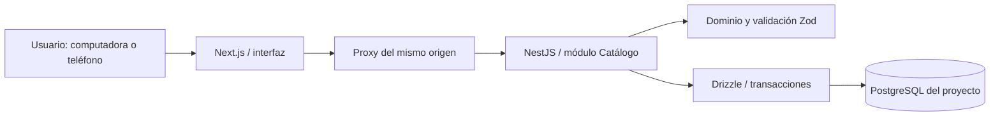

# Arquitectura de la fase 1

## Decisión principal

Monolito modular con una API NestJS centralizada y una base PostgreSQL. Next.js presenta la interfaz y reenvía solicitudes del mismo origen; no decide reglas comerciales ni habla directamente con la base. Los procesos de interfaz y API pueden ejecutarse de forma independiente sin convertir el sistema en microservicios.

`packages/domain` no depende de React, NestJS ni PostgreSQL. `packages/database` contiene el esquema tipado y sus migraciones; la interfaz utiliza solamente los tipos de catálogo del dominio. La API contiene controladores, servicio y persistencia del módulo Catálogo. Los módulos comerciales posteriores se añadirán con sus propios servicios, sin llevar reglas a componentes React.

## Contrato HTTP

| Método | Ruta                              | Comportamiento                                     |
| ------ | --------------------------------- | -------------------------------------------------- |
| GET    | `/api/health`                     | Comprueba conexión real a PostgreSQL               |
| GET    | `/api/catalog`                    | Catálogo consistente en una transacción de lectura |
| POST   | `/api/catalog/fruits`             | Crea fruta                                         |
| POST   | `/api/catalog/varieties`          | Crea variedad de una fruta                         |
| POST   | `/api/catalog/calibers`           | Crea calibre de una fruta                          |
| POST   | `/api/catalog/configurations`     | Crea variante y empaque en una única transacción   |
| PATCH  | `/api/catalog/configurations/:id` | Actualiza empaque verificando su versión           |

Las mutaciones requieren `Idempotency-Key` UUID. Se bloquea la clave en PostgreSQL, se compara una huella SHA-256 del comando y se conserva la respuesta. La auditoría se inserta dentro de la misma transacción. Las actualizaciones bloquean la fila y comparan `version`; una edición desactualizada devuelve 409. Los nombres duplicados se detectan sin distinguir mayúsculas y espacios exteriores.

La lectura agrupa cuatro consultas dentro de un snapshot `repeatable read`. Se ejecutan secuencialmente porque comparten una conexión. No hay consultas por cada fila ni exposición de clientes de base al navegador.

## Modelo PostgreSQL

24 tablas y una vista de cuentas por cobrar:

| Área                 | Tablas / vista                                                                           |
| -------------------- | ---------------------------------------------------------------------------------------- |
| Catálogo             | `fruits`, `varieties`, `calibers`, `product_variants`, `packing_rules`                   |
| Abastecimiento       | `suppliers`, `purchases`, `purchase_lines`, `lots`                                       |
| Inventario           | `warehouses`, `containers`, `stock_balances`, `inventory_movements`, `inventory_entries` |
| Comercial            | `clients`, `price_lists`, `price_items`, `sales`, `sale_lines`                           |
| Cobranza             | `payments`, `payment_applications`, vista `receivables`                                  |
| Tasas y trazabilidad | `bcv_rates`, `audit_events`, `command_receipts`                                          |

Se usan UUID, timestamps con zona horaria, claves foráneas, índices para relaciones y búsquedas, unicidad y restricciones de cantidades. Las claves compuestas impiden combinar una variedad/calibre de otra fruta y vincular un lote a una regla de otra variante. Las aplicaciones relacionan pago y venta del mismo cliente. Almacenes se modelan desde el inicio, sin interfaz ni lógica compleja de sucursales.

Las 17 tablas de los demás módulos comerciales son fundamentos: no tienen endpoints operativos ni permisos de escritura concedidos a la aplicación. Auditoría e idempotencia sí están habilitadas para acompañar las operaciones del catálogo. Ventas y cobranza requieren servicios y controles adicionales descritos en `domain-rules.md` antes de usarse comercialmente.

## Migraciones

- `0000_thick_sunset_bain.sql`: esquema generado con Drizzle.
- `0001_integrity.sql`: funciones y triggers versionados para historial inmutable, ciclos y doble conteo.
- `0002_noisy_red_ghost.sql`: validación estricta del dominio oficial BCV; los puntos del dominio son literales.

Los nombres aleatorios de migración proceden de Drizzle y no afectan al negocio. El journal y las instantáneas se versionan. El migrador toma un bloqueo asesor, aplica solo pendientes y concede permisos mínimos al rol local. No se alteró una migración ya aplicada para ocultar un cambio.

## Ejecución local

- Web: `127.0.0.1:3100`.
- API: `127.0.0.1:3101`.
- PostgreSQL: `127.0.0.1:55432`, directorio `.local/postgres`.
- Bases separadas: `manzanas_maracay_dev` y `manzanas_maracay_test`.
- Pruebas web/API: puertos 3200 y 3201.

La ausencia de Docker local se resolvió con binarios PostgreSQL reales mediante `embedded-postgres`, no con SQLite ni almacenamiento del navegador. El paquete de arranque tiene versión beta; se limita a desarrollo. Para producción se propone PostgreSQL estándar en contenedor o servicio dedicado después de revisar despliegue y respaldo.

La API usa `mm_app`, sin privilegios de creación, superusuario ni escritura en módulos futuros. `mm_owner` se utiliza solo en preparación y migraciones. El proxy añade una clave interna del servidor y valida origen en mutaciones. Esto protege el entorno local frente a peticiones triviales de otros sitios, pero **no reemplaza autenticación de usuarios**. No publicar esta versión.

## PWA y límites

Manifiesto, iconos tipográficos temporales y service worker con una página de desconexión. No se almacenan respuestas del catálogo ni se encolan escrituras. Las capturas prueban tamaños de teléfono en Chromium; no equivalen a validación en todos los dispositivos o en Safari. La aplicación escucha solo en la computadora local; usarla desde un teléfono físico requiere una decisión posterior sobre acceso seguro.

## Antes de producción

Autenticación real, gestión de sesión, respaldo y restauración ensayados, revisión del modelo de inventario transaccional, auditoría con actor autenticado, paginación para catálogos grandes, observabilidad, límites de solicitudes, despliegue aislado y verificación oficial de BCV. No se incorporan como funciones simuladas en la fase 1.
