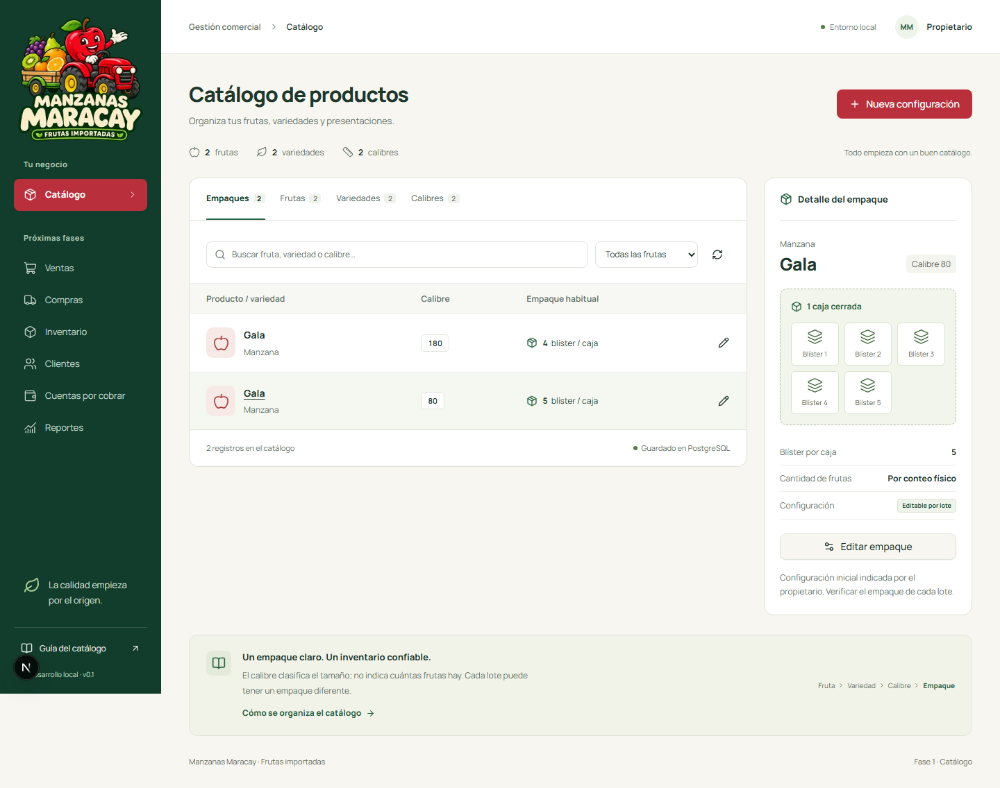

# Entrega de la fase 1 — Manzanas Maracay

**4 de noviembre de 2026. Implementación local verificada. Sin despliegue público.**

## Resultado

Se construyó un proyecto independiente con un catálogo funcional: permite crear y consultar frutas, variedades y calibres, configurar los blíster por caja, editar empaques, buscar y filtrar. Los cambios llegan a una API NestJS y se guardan en PostgreSQL; no dependen de datos simulados en el navegador.

El diseño utiliza verde oscuro, rojo manzana y crema, fuente Manrope, tabla profesional, editor de empaque y formularios adaptados al teléfono. El propietario entregó el logo oficial el 4 de noviembre de 2026 para sustituir la firma provisional; el original se conserva en `apps/web/public/brand/logo-manzanas-maracay.png`. Las imágenes suministradas como modelos se conservaron por separado en `docs/referencias`. Véase [activos de marca](brand-assets.md).

## Tecnologías utilizadas

| Tecnología               | Versión                                           |
| ------------------------ | ------------------------------------------------- |
| Node.js / npm            | 24.19.0 / 11.17.0                                 |
| TypeScript               | 7.0.2                                             |
| Next.js / React          | 16.4.5 / 19.3.1                                   |
| NestJS                   | 12.3.3                                            |
| PostgreSQL               | 18.6                                              |
| Drizzle ORM / Kit        | 0.45.4 / 0.31.11                                  |
| Tailwind CSS             | 4.3.4                                             |
| shadcn CLI / Radix UI    | 4.23.0 / 1.8.1                                    |
| Vitest                   | 5.1.0                                             |
| Playwright               | 1.64.1                                            |
| axe-core para Playwright | 4.14.0                                            |
| Zod / Decimal.js         | 4.6.7 / 10.6.0                                    |
| PostgreSQL portable      | embedded-postgres 18.6.0-beta.19, solo desarrollo |

Las versiones completas y sus integridades se conservan en `package-lock.json`; el resumen está en `docs/versions.json`. Se usa npm workspaces. No se instalaron herramientas globales para adaptar proyectos anteriores.

## Skills

Instaladas dentro de `.agents/skills`, desde revisiones oficiales fijadas: **frontend-design**, **shadcn**, **web-design-guidelines** y **vercel-react-best-practices**. Se revisaron instrucciones, archivos y el script de shadcn antes de instalar. No se ejecutaron scripts externos destructivos ni se consultaron secretos de otros proyectos. Detalles, revisiones y ejemplos de uso: [Skills](skills.md).

## Estructura y arquitectura

- `apps/web`: interfaz Next.js y proxy de solicitudes del mismo origen.
- `apps/api`: monolito modular NestJS con módulo Catálogo.
- `packages/domain`: validaciones y reglas puras.
- `packages/database`: esquema Drizzle, índices, restricciones y migraciones.
- `scripts` e `infra`: inicio local, migración, datos iniciales y alternativa Docker Compose.
- `tests`: pruebas unitarias y escenarios de navegador/API/PostgreSQL.
- `AGENTS.md` y `docs/domain-rules.md`: instrucciones permanentes para continuar el proyecto.

La documentación explica separación entre interfaz, negocio, persistencia e infraestructura, y cómo incorporar los módulos siguientes sin mover las reglas al navegador. Véase [arquitectura](architecture.md).

## Base de datos creada

Se crearon `manzanas_maracay_dev` y `manzanas_maracay_test` en una instancia PostgreSQL propia, ligada a `127.0.0.1:55432`, con datos persistentes en `.local/postgres`. La aplicación usa un rol sin privilegios de superusuario.

Hay **24 tablas, una vista de cuentas por cobrar y tres migraciones**. El modelo cubre catálogo, proveedores, compras, lotes, almacenes, contenedores, existencias, movimientos, clientes, precios, ventas, pagos, aplicaciones, tasas BCV, auditoría e idempotencia. Solo catálogo, auditoría y recibos de comandos están habilitados para la aplicación en esta fase.

Se verificaron unicidad, relaciones entre frutas y sus variantes, cantidades válidas, auditoría inmutable, control de concurrencia y protección contra el doble conteo de un contenedor y su contenido. El modelo completo de movimientos está documentado y probado en sus reglas iniciales; todavía no existe una pantalla ni un servicio de inventario operativo.

## Pantalla funcional

Las cuatro pestañas —Empaques, Frutas, Variedades y Calibres— realizan operaciones reales. La pantalla incluye carga, vacío, éxito, error de conexión, reintento y mensajes de validación. La edición de un empaque conserva su auditoría y rechaza una versión desactualizada.

Los únicos datos iniciales son los ejemplos del propietario: Manzana, Pera, Gala, Pink Lady, calibres 80 y 180, y Gala con 5 y 4 blíster respectivamente. No son existencias. No se generaron ventas, saldos ni tasa BCV ficticia.

La PWA contiene manifiesto, iconos derivados del logo oficial y página de desconexión. No procesa operaciones comerciales sin conexión.

[Captura de teléfono](capturas/catalogo-movil.png) · [Formulario de teléfono](capturas/formulario-movil.png)

## Verificación realizada

| Comprobación                                    | Resultado final                                                      |
| ----------------------------------------------- | -------------------------------------------------------------------- |
| TypeScript en API, dominio, base e interfaz     | Correcto                                                             |
| Compilación de NestJS y Next.js                 | Correcta                                                             |
| Vitest                                          | **11 de 11 pruebas aprobadas**                                       |
| Playwright, API y SQL                           | **13 de 13 escenarios aprobados**                                    |
| axe-core en escritorio y teléfono               | Sin infracciones en los criterios automatizados WCAG 2 A/AA y 2.1 AA |
| Persistencia tras recarga                       | Comprobada en creación y edición                                     |
| Solicitudes simultáneas con la misma clave      | Un registro y una auditoría; sin duplicados                          |
| Edición simultánea                              | Una actualización y un conflicto controlado                          |
| Origen ajeno y API interna                      | Acceso de escritura rechazado                                        |
| Conservación de fruta y doble conteo            | Casos inválidos rechazados                                           |
| PWA sin conexión                                | Página de desconexión comprobada                                     |
| Inicio local y capturas con datos de desarrollo | Comprobados                                                          |
| Cierre de procesos de prueba                    | PostgreSQL detenido conservando datos                                |

Los fallos detectados durante el desarrollo se corrigieron antes de esta entrega. Entre ellos: contraste del pie, vínculo de pestañas/paneles, pestaña recortada en móvil, selectores ambiguos de pruebas y cierre de procesos PostgreSQL en Windows. La ejecución previa a incorporar el logo aprobó los 13 escenarios de Playwright en 32,4 segundos; las 11 pruebas de dominio también pasaron.

Después de incorporar el logo oficial se repitieron tipos, compilación y las 24 pruebas: todas aprobadas. La ejecución de Playwright tardó 40,9 segundos e incluyó la comprobación del logo en la página sin conexión.

La suite unitaria comprueba el ejemplo de 3 cajas/5 blíster, uso de blíster ya abiertos, saldo insuficiente, medias cajas por conteo físico, sobrescritura por lote, calibres de texto, precios negociados, precisión decimal y rechazo de tasas BCV inválidas. Los números de tasa usados allí son exclusivamente sintéticos.

Se observaron avisos no bloqueantes del entorno sobre variables de color de terminal y la futura configuración nativa de Vite. No impidieron compilar ni probar.

## VPS y hosting

Tras recibir los accesos, se inspeccionó el VPS con SSH y verificación del servidor conocido. Resultado: Ubuntu 24.04.5 LTS, 8 CPU, aproximadamente 24 GB de RAM y 272 GB libres; Docker y Compose disponibles.

No se creó ni desplegó nada en el VPS. No se alteraron contenedores, bases, puertos, DNS, firewall, proxy ni certificados. Se observó un worker de Auditoría que ya estaba reiniciándose y no se intervino. El hosting pago no se utilizó. [Informe de infraestructura](infrastructure.md).

El archivo de accesos del propietario y su llave no forman parte del proyecto, de las capturas ni del paquete de entrega.

## Limitaciones y pendientes

1. **Repositorio privado autorizado:** [milanexpress2026-commits/manzanas-maracay](https://github.com/milanexpress2026-commits/manzanas-maracay), rama de trabajo `phase-1/foundations`. Se conserva la [descripción preparada para revisión](pull-request.md). No hay PR porque el repositorio nuevo no tiene aún una rama base distinta; no se realizó merge ni despliegue.
2. **Docker Compose preparado, no ejecutado:** Docker no está instalado en esta computadora. Se verificó PostgreSQL real portable. Antes de adoptar Compose se debe validar ese camino en un entorno aislado.
3. **Acceso solo local:** esta fase no incorpora autenticación de producción y no debe exponerse a Internet. El token entre interfaz y API no sustituye el inicio de sesión de personas.
4. **BCV desacoplado, sin conexión automática:** no se obtuvo un dato oficial vigente verificable ni se afirmó que exista una API oficial. El proveedor sin configurar devuelve ausencia de tasa.
5. **Inventario, ventas y cobranza no operativos:** hay fundamentos SQL y reglas, pero faltan servicios transaccionales completos, pruebas de aplicación de pagos y el diseño de las siguientes fases.
6. **Cobertura de dispositivos:** se verificó Chromium con tamaños de escritorio y móvil. Quedan pruebas en dispositivos reales, Safari y lector de pantalla.

## Cómo abrir y continuar

En la carpeta del proyecto, ejecutar `npm run dev` y abrir **http://127.0.0.1:3100**. Instrucciones completas en [README](../README.md). Los servicios se dejan detenidos al finalizar la revisión; el iniciador los vuelve a levantar sin perder registros.

Próximo paso recomendado: revisar el catálogo con el propietario y confirmar las configuraciones de empaque. Después de aprobar esta fase, diseñar e implementar recepción de lotes y fraccionamientos con conteos físicos, reversas y pruebas de concurrencia. No se avanzó automáticamente a esa fase.

Para trasladar el contexto a otra conversación, utiliza el [prompt de continuación](continuar-en-chatgpt.md), que señala los documentos y límites que deben conservarse.

## Fuentes técnicas consultadas

Se verificaron instrucciones actuales de [Next.js](https://nextjs.org/docs/app/getting-started/installation), [NestJS](https://docs.nestjs.com/first-steps), [Drizzle](https://orm.drizzle.team/docs/migrations), [shadcn/ui](https://ui.shadcn.com/docs/skills) y [embedded-postgres](https://github.com/leinelissen/embedded-postgres). Las procedencias de Skills están documentadas por separado en [skills.md](skills.md).
